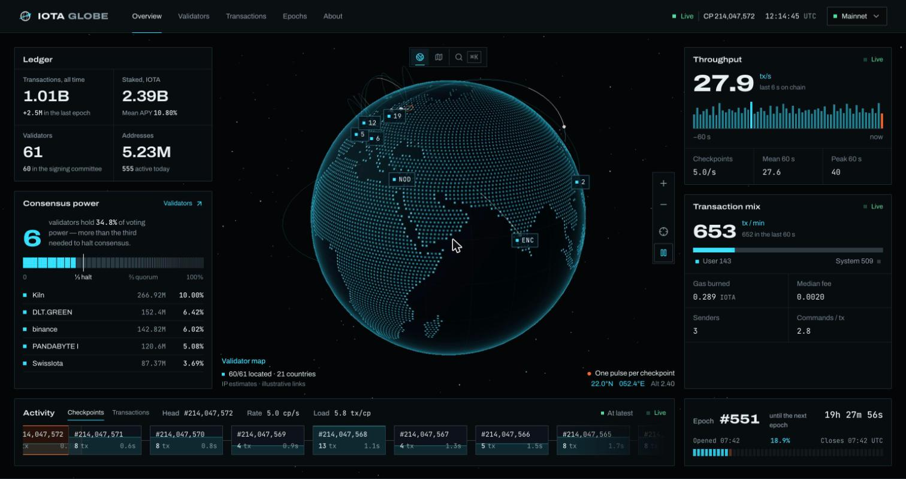
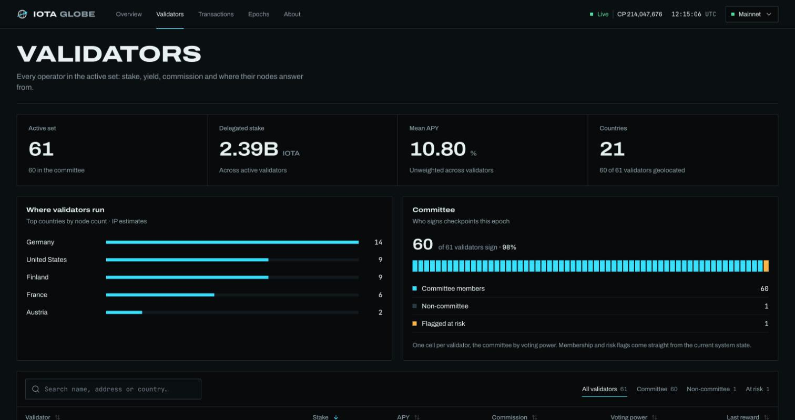
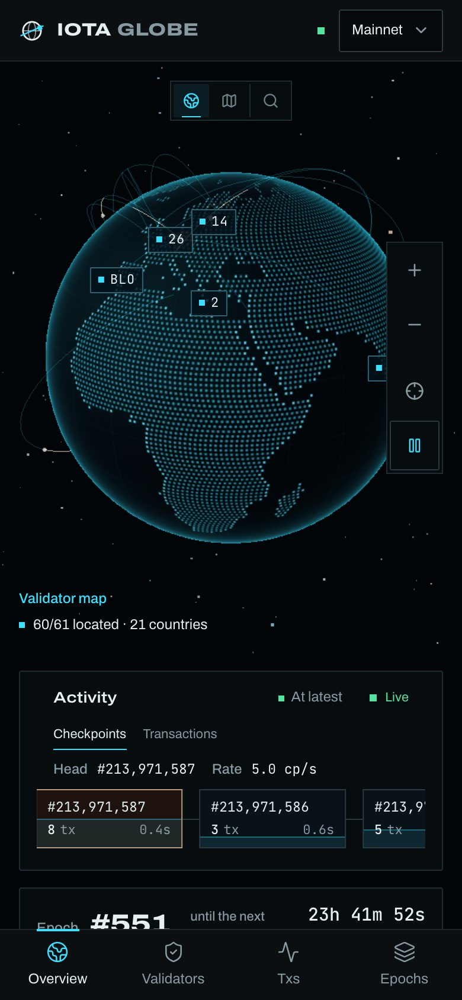
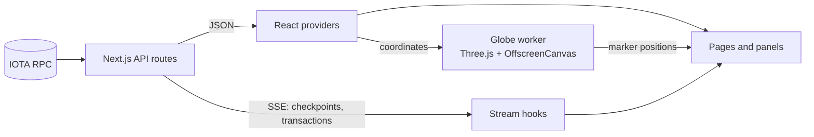

# IOTA Globe

[](https://github.com/Snowyq/iota-globe/actions/workflows/ci.yml)


A live observatory for the IOTA network. Validators on a 3D globe or a flat map, every certified checkpoint as it lands, throughput, transactions, stake and epoch history.

**[Live demo](https://iota-globe.vercel.app/)**



<p>
  
  
</p>

## Features

- **Globe and flat map** rendered by Three.js in a Web Worker on an `OffscreenCanvas`, with a pulse for every checkpoint.
- **Validator search** (`⌘K`) that flies the camera to a validator; clusters open into a searchable inspector.
- **Live chain strip and throughput** from a checkpoint stream with ~0.4 s lag.
- **Validators** directory with sorting, filters, pagination and per-validator stake, APY and rewards.
- **Transactions** feed with sender/digest search, type filters and pause.
- **Epoch history** with cursor pagination and charts.
- Mainnet / testnet switch, keyboard navigation, reduced-motion support, phone layout.

## Architecture



- RPC calls stay on the server. The browser only talks to `/api/*`.
- One server-side tail per network polls checkpoints and fans them out to every SSE client, so many open tabs cost one poll.
- Incoming checkpoints are merged into state once per animation frame, so a reconnect backlog is a single render.
- The worker owns Three.js, the land mask and the camera. React keeps the controls and HTML markers, which are moved with transforms only.
- Switching networks drops in-flight requests so late responses can't overwrite the new network's data.

## Tech stack

Next.js 16 (App Router), React 19, TypeScript, Tailwind CSS 4, Three.js, Recharts, GSAP + Lenis (about page), IOTA SDK, Vitest + Testing Library.

## Getting started

```bash
pnpm install
cp .env.example .env.local   # public IOTA indexer endpoints
pnpm dev
```

## Scripts

| Command              | What it does                    |
| -------------------- | ------------------------------- |
| `pnpm dev`           | Dev server                      |
| `pnpm build`         | Production build                |
| `pnpm test`          | Unit and functional tests       |
| `pnpm test:coverage` | Tests with a V8 coverage report |
| `pnpm lint`          | ESLint                          |
| `pnpm typecheck`     | TypeScript                      |
| `pnpm format:check`  | Prettier                        |

## Tests

Vitest runs two projects: pure logic in Node (formatting, stats, clustering, fetch deadlines, stream math, checkpoint and transaction hubs) and functional tests in jsdom (network races, stream hooks, the worker adapter, navigation and the main pages). Tests use fixtures and never hit a live RPC. CI runs format, lint, typecheck, tests and build on every push.

## Project structure

```text
app/                 routes and API (RPC proxy, SSE streams)
features/globe/      worker renderer, markers, inspector, search
features/dashboard/  overview panels
features/network/    network snapshot and live streams
features/validators/ validator data, stats and directory
features/about/      project page
lib/                 fetch, stream hubs, formatting
views/               page composition
tests/               unit and functional tests
```

Validator locations are IP-based estimates. The first globe prototype was inspired by [gmonads.com](https://www.gmonads.com/).
